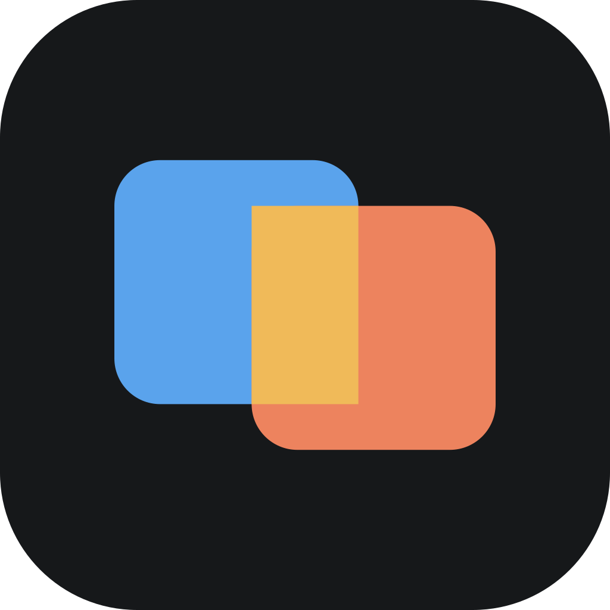

#  SchemaDiff

로컬에서 실행하는 DB 스키마 비교 도구. FROM(기준)·TO(대상) DB 에 직접 접속해 메타데이터를 비교하고, TO 를 FROM 에 맞추는 동기화 SQL 을 만든다. 현재 Oracle 만 지원.

## 실행

- 배포 파일은 `SchemaDiff.exe` 하나다. 쓸 폴더(예: `D:\tools\SchemaDiff\`)에 두고 더블클릭하면 브라우저에 `http://127.0.0.1:8765/` 가 열린다.
- 실행 중에는 작은 「SchemaDiff 실행 중」 창이 뜬다. 이 창을 닫거나 「종료」를 누르면 끝난다. 이미 실행 중이면 브라우저만 연다.
- 필요한 것: Java 11 이상(JRE 또는 JDK). 레지스트리(JavaSoft)에 등록된 Java 를 먼저 찾고, 없으면 `JAVA_HOME`·`PATH` 의 Java 를 쓴다.
  - Java 를 못 찾으면 경고 창을 띄우고 Java 다운로드 페이지(adoptium.net)를 연다(이 창은 Launch4j 가 띄워 영어다).
  - 찾은 Java 가 11 미만이면 「Java 11 이상이 필요합니다」 창을 띄운다.
- 데이터(`data/`)는 exe 옆에 생긴다. 다른 폴더로 옮길 때는 `data/` 도 함께 옮긴다.

## 빌드

`build.bat` → `dist\SchemaDiff.exe`. JDK 11 이상의 `javac`·`jar` 와 [Launch4j](https://launch4j.sourceforge.net/)(`choco install launch4j`)를 쓴다. Launch4j 위치가 기본(`C:\Program Files (x86)\Launch4j`)과 다르면 `LAUNCH4J_HOME` 을 설정한다.

- `lib/*.jar` 를 풀어 `build\schemadiff.jar` 하나로 묶고, `launch4j.xml` 설정으로 exe 에 감싼다.
- 진입점 `src/boot/schemadiff/Boot.java` 만 `--release 8` 로 컴파일한다. Java 8 에서도 읽혀야 버전 안내 창을 띄울 수 있기 때문이다.
- 빌드는 `dist\` 에 만들므로, 쓰는 폴더의 SchemaDiff 가 실행 중이어도 막히지 않는다. 새 버전은 SchemaDiff 를 닫고 `dist\SchemaDiff.exe` 를 쓰는 폴더에 덮어쓴다.

## 개발 실행

`dev.bat` → 소스를 `build\dev` 로 컴파일해 `http://127.0.0.1:8766/` 로 띄운다. 평소 쓰는 SchemaDiff(8765)와 함께 켤 수 있다.

- 데이터는 `dev-data\` 를 쓴다(git 제외). 평소 데이터로 시험하려면 `data\` 내용을 복사해 둔다.
- 화면 파일은 `src\web` 에서 바로 읽는다. `app.js`·`style.css` 는 고친 뒤 브라우저만 새로 고치면 된다.
- Java 를 고쳤으면 dev 창을 닫고 `dev.bat` 을 다시 실행한다.
- 시스템 속성 `schemadiff.port`·`schemadiff.data`·`schemadiff.web` 으로 포트·데이터 폴더·화면 파일 폴더를 바꾼다(`dev.bat` 이 쓰는 방식).

- `lib/ojdbc11.jar`: Oracle JDBC 23.9. 비밀번호가 옛 10G 방식인 계정도 접속된다(python-oracledb thin 은 `DPY-3015` 로 실패).
- `lib/jackson-*.jar`: JSON.

## 데이터 (`data/`, exe 옆에 생김)

| 파일 | 내용 |
|---|---|
| `connections.json` | 저장된 연결. 비밀번호는 Windows DPAPI(CurrentUser)로 암호화 — 이 PC 의 이 Windows 계정에서만 풀린다 |
| `settings.json` | `exclude`: 비교에서 뺄 백업·임시 테이블·시퀀스 이름 정규식 |
| `history/` | 비교 결과(`*.json.gz`)와 목록용 요약(`*.meta.json`). 화면의 「이력」에서 다시 연다 |

## 비교 규칙

- 오브젝트: 테이블(컬럼·주석), 인덱스, 제약조건, 시퀀스, 뷰(컬럼·주석), 프로시저, 함수, 트리거, 패키지·타입
- NUMBER(*,0)=NUMBER(38), DEFAULT NULL=기본값 없음, 컬럼 순서는 비교하지 않는다(「컬럼 순서만 다름」으로 표시)
- 뷰·코드 원문은 공백·빈 줄 차이를 무시하고, 원문 안의 자기 스키마 접두어(`APP_OWNER.`)를 떼고 비교한다
- 뷰·코드의 컴파일 상태(VALID/INVALID)와 뷰 컬럼 정의(바탕 테이블에 따라 정해짐)는 참고로만 보이고 차이로 세지 않는다
- 시스템 생성 이름(SYS_C…)의 인덱스·제약조건은 구성으로 짝짓고, 이름만 다르면 RENAME 을 낸다
- 동기화 SQL: TO 에만 있는 것의 DROP 은 주석으로만 낸다. 길이 축소·타입 변경·NOT NULL 추가는 「주의」 주석. FROM 주석이 비었거나 깨진(`??`) 경우 TO 주석을 덮지 않는다

## 보안

`127.0.0.1` 에만 열린다. Host 헤더가 `127.0.0.1:8765`/`localhost:8765` 가 아니거나 API 요청에 `X-SchemaDiff: 1` 헤더가 없으면 거부한다(다른 사이트의 스크립트가 이 서버를 부르지 못하게).

## 새 DBMS 추가

`Adapter` 인터페이스를 구현하고 `Main.ADAPTERS` 에 등록, 화면 `app.js` 의 `DBMS` 목록에서 활성화한다. 드라이버 jar 는 `lib/` 에 넣는다.
